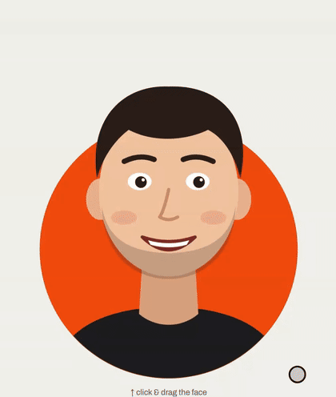

# taffy-face

<p align="center"><a href="https://arjunkshah12345-hash.github.io/taffy-face/"></a></p>

**Pull my face.** Grab any part of a photo, stretch it like taffy, and let go to watch it spring back. When you pull hard enough it can switch to an "ouch" face.

An open-source remake of the effect on [@rameerez's site](https://x.com/rameerez/status/2115858625180946827). It's one file with no dependencies and about 300 lines of WebGL2.

**[▶ Pull Dario Amodei's face](https://arjunkshah12345-hash.github.io/taffy-face/)**, then switch to your own: upload or paste a photo. Nothing leaves your browser.

## Use it on your site

```html
<canvas id="face" style="width:500px;height:600px"></canvas>
<script type="module">
  import { createTaffy } from "https://cdn.jsdelivr.net/gh/arjunkshah12345-hash/taffy-face/taffy.js";

  createTaffy(document.getElementById("face"), {
    src: "me.png",          // transparent PNG works best
    grabSrc: "me-ouch.png", // optional: shown while you're pulling
  });
</script>
```

Or copy `taffy.js` into your project and `import { createTaffy } from "./taffy.js"`.

### Getting a cut-out photo (30 seconds)

- **Mac / iPhone:** open the photo, right-click or long-press the person, choose **Copy Subject**, then paste it into the demo (⌘V) or save it as a PNG.
- **Anywhere else:** use any background remover (remove.bg, Photoroom, Canva…) and export a PNG.
- **"Ouch" photo:** take a second shot from the same spot with a silly face, and cut it out the same way. Both images need the same size and framing.

A photo that still has its background also works. The whole rectangle just becomes stretchy.

## Options

| Option | Default | What it does |
|---|---|---|
| `src` | — | Rest image: URL, `File`/`Blob`, `` or `<canvas>` |
| `grabSrc` | `null` | Image shown while being pulled |
| `radius` | `0.16` | Size of the pulled region (fraction of image width) |
| `maxStretch` | `1.1` | How far it stretches, in image widths (rubber-banded) |
| `stiffness` | `240` | Spring-back strength |
| `damping` | `10` | Lower = more jiggle |
| `dragStiffness` / `dragDamping` | `1400` / `70` | How tightly the skin follows the cursor |
| `ouchDistance` | `0.05` | Pull distance before switching to `grabSrc` |
| `align` | `"center"` | `"center"` or `"bottom"` inside the layout box |
| `layout` | 15% inset | `(w, h) => ({ x, y, w, h })` box the image is fit into (CSS px) |
| `grid` | `56` | Mesh resolution |

Only opaque pixels can be grabbed. Leave room in the canvas around the image so the stretch has somewhere to go.

### API

```js
const face = createTaffy(canvas, opts);
await face.ready;
face.setImage(fileOrUrl);          // swap the rest image
face.setImage(fileOrUrl, "grab");  // swap the ouch image (null to remove)
face.on("grab" | "release" | "ouch" | "calm", fn);
face.set({ damping: 6 });          // tweak options live
face.destroy();
```

### The "head pops out of a circle" look

See `index.html`. An orange disc sits behind the canvas. A CSS mask shows the canvas only inside the disc plus everything above the disc's center line, so the shoulders get clipped by the circle and the head sticks out the top.

## How it works

The image is drawn on a 56×56 triangle mesh. When you grab, every vertex gets a Gaussian weight based on its distance from the grab point. While dragging, each vertex springs toward `pull × weight`. On release it springs back to rest with an underdamped spring, which gives the jiggle. Vertices with more weight are drawn in front, so the pulled part overlaps the rest of the face.

## License

Code: MIT.

The example photo of Dario Amodei (`assets/dario.webp`) is by [TechCrunch](https://commons.wikimedia.org/wiki/File:Dario_Amodei_at_TechCrunch_Disrupt_2023_02_(cropped).jpg), licensed [CC BY 2.0](https://creativecommons.org/licenses/by/2.0/), with the background removed and cropped. It isn't covered by the MIT license. This is a fan-made toy, not affiliated with or endorsed by Dario Amodei or Anthropic.
